# KEIZ — Technical Architecture

This document is the map of how KEIZ is wired: runtimes, trust boundaries, the
invoice and payment state machines, and the three login/settlement/agent flows.
Diagrams are Mermaid and render on GitHub.

- **Web** — Next.js 16 App Router, React 19, Tailwind 4
- **API** — NestJS 12, Mongoose 9, MongoDB
- **Chain** — NEAR RPC, NEAR Intents 1Click, NEAR Auth (FastAuth), OutLayer custody, NEAR AI Cloud

---

## 1. System context

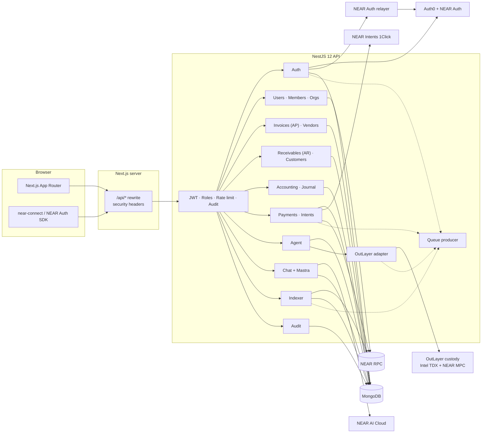

---

## 2. Monorepo map

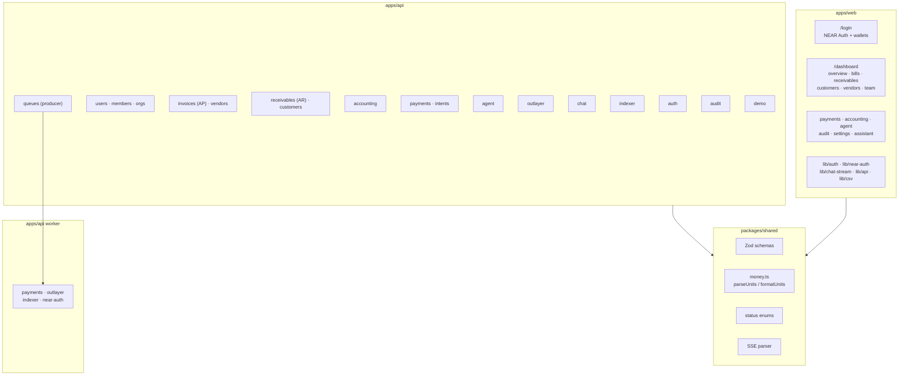

Web routes (App Router, client-rendered):

| Route | Purpose |
|---|---|
| `/` | Landing page. |
| `/login` | The only sign-in entry: NEAR Auth card + NEAR wallet selector. |
| `/dashboard` | Overview. |
| `/dashboard/invoices`, `/dashboard/invoices/[id]` | AP bills and detail (approve, quote, pay). |
| `/dashboard/receivables`, `/dashboard/receivables/[id]` | AR invoices, receipts and collection quote. |
| `/dashboard/customers`, `/dashboard/customers/[id]` | Customers and their receivables. |
| `/dashboard/vendors`, `/dashboard/vendors/[id]` | Vendors, payout details and bills. |
| `/dashboard/team` | Members and roles. |
| `/dashboard/payments`, `/dashboard/payments/[id]` | Payment history, open quotes and payment timeline. |
| `/dashboard/accounting` | Journal, trial balance, aging, manual entry. |
| `/dashboard/agent` | Agent wallet, policy, actions and custody handoff. |
| `/dashboard/audit` | Append-only audit log (ADMIN/OWNER). |
| `/dashboard/settings` | AR collection contract config and workspace settings. |
| `/dashboard/chat` | Full-page assistant (also available as a drawer). |
| `/privacy`, `/terms` | Legal pages. |

---

## 3. Request lifecycle

Every browser call goes through the Next proxy, so the httpOnly session cookie
stays same-origin. The global guards run before any controller.

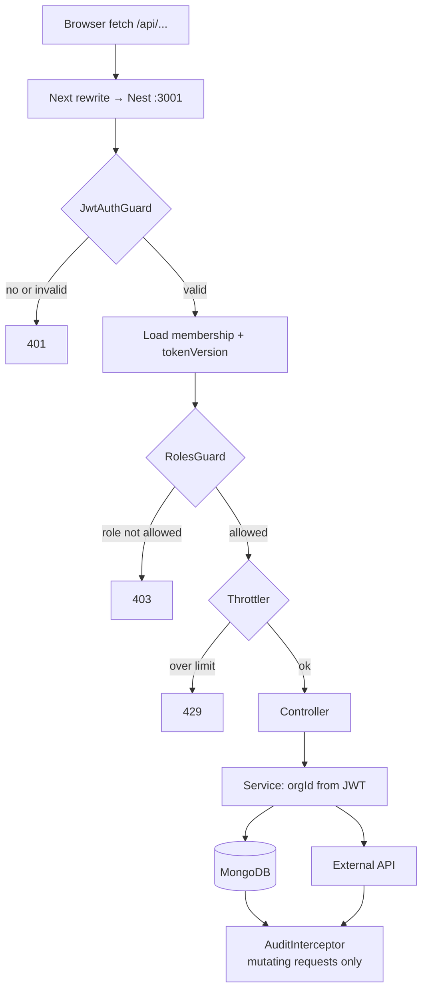

---

## 4. Authentication

### 4.1 NEAR Auth (Auth0 + MPC)

Auth0 handles passkey/Google/Apple/email login. The browser SDK derives the
MPC key, requests a NEP-413 message signature, and builds the `sign` action.
The API relayer submits it to `fast-auth`; only the configured contract and
`jwt#https://<auth0-domain>/` guard are accepted, with a 1 yoctoNEAR deposit.

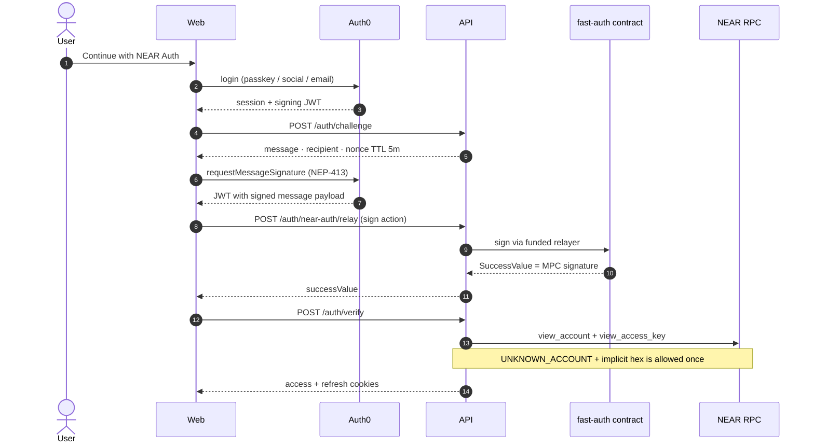

### 4.2 Wallet (NEP-413)

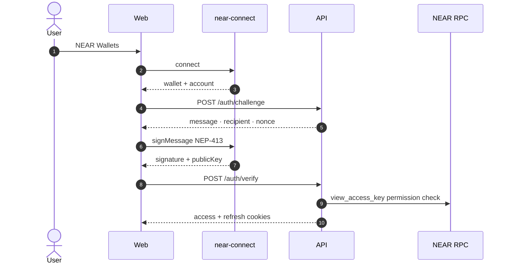

NEP-413 payload: Borsh `tag(2^31+413) || message || nonce[32] || recipient || Option<callback>`
→ SHA-256 → Ed25519. Nonces are single-use and TTL-indexed.

---

### 4.3 On-chain AR/AP contracts

`contracts/keiz-collect` receives NEP-141 customer payments and records them by
receivable reference. 1Click can deliver cross-chain AR by sending
`ft_transfer_call` with `customRecipientMsg = {"receivableRef":"AR-2001"}`.

`contracts/keiz-vault` is the AP treasury. It checks policy at proposal and again
at execution, requires M-of-N approval, and can pay either a vendor directly or
a committed 1Click deposit address for cross-chain payouts. The intended split is
that the API coordinates the 1Click quote/status while the contract only moves
NEP-141 tokens; that wiring is not implemented yet, so the vault is operated
separately. The NEAR Auth relayer remains restricted to `fast-auth.sign` and is
not used for treasury calls.

### 4.4 Payment intents and rails

`PaymentIntent` is the single live payment obligation for an invoice. It records
the chosen rail (`oneclick`, `outlayer`, `vault`) and is unique for
`OPEN`/`EXECUTING` states. `PaymentAttempt` records each rail execution. A rail
must reserve an intent before moving funds; terminal payment status updates the
intent and attempts atomically. This is the cross-rail double-payment guard.

`oneclick` and `outlayer` are executed today. `vault` is **reserved**: the enum value and
indexes exist, but `InvoicesService`/`PaymentsService` have no vault execution path yet. Do
not treat a `vault` intent as a live payment until that wiring lands.

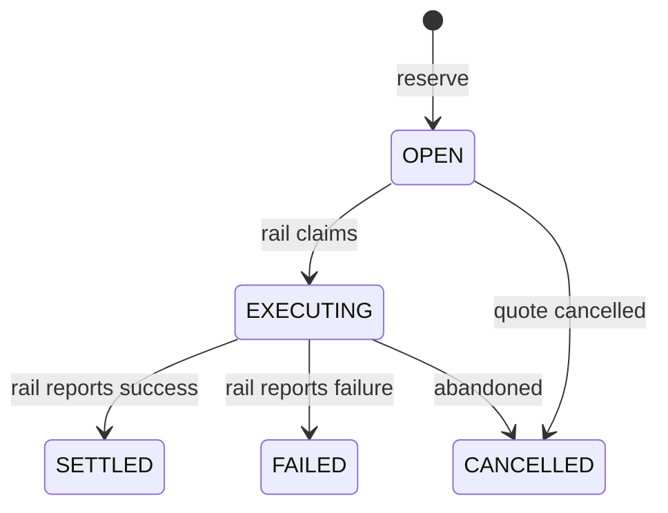

## 5. Invoice and 1Click settlement

The invoice is approved first, then a quote is committed. The deposit is signed
in the user's wallet. In `intents` mode the API verifies the transaction against
NEAR RPC before forwarding it to 1Click.

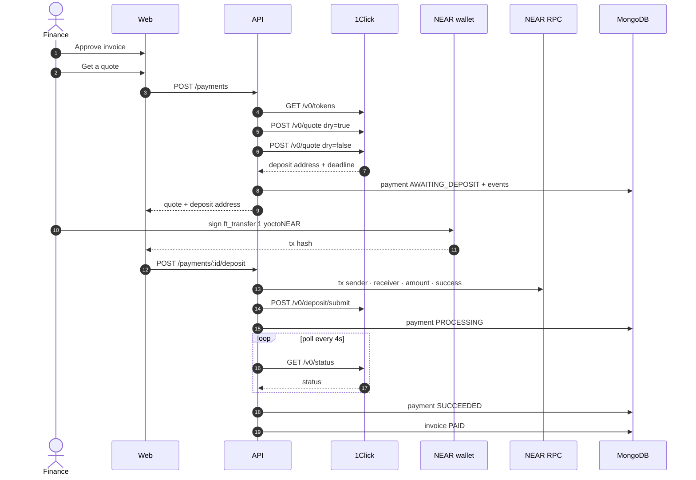

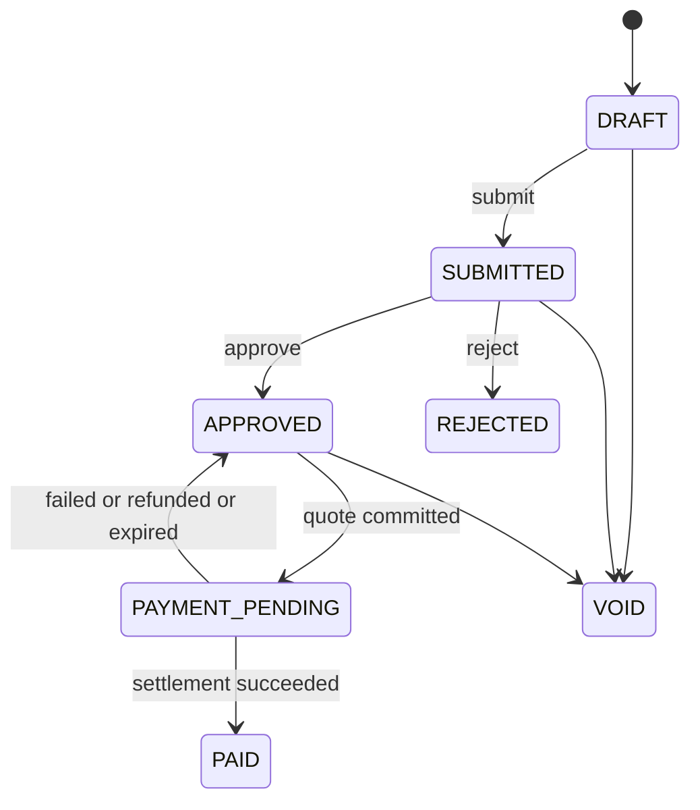

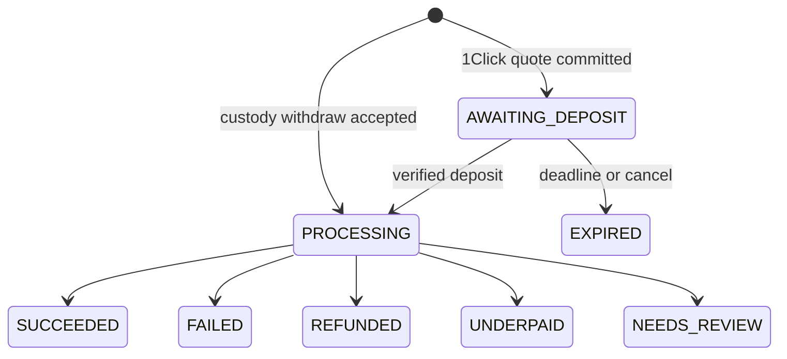

`QUOTED` belongs to `PaymentIntent`, not `Payment`: the committed quote is persisted directly
as `AWAITING_DEPOSIT`. A 1Click `SUCCESS` without a destination transaction hash is stored as
`NEEDS_REVIEW`, not `SUCCEEDED`.

---

## 5.1 AP, AR and the ledger

Bills and customer invoices are subledgers; the journal is the accounting source of truth.
Mongo is a single node, so a status change and its journal entry cannot be atomic. The API
commits the business state first, posts with a deterministic `dedupeKey`, and exposes an
idempotent `rebuild` for any gap. Journal entries are immutable; a void posts a reversal.

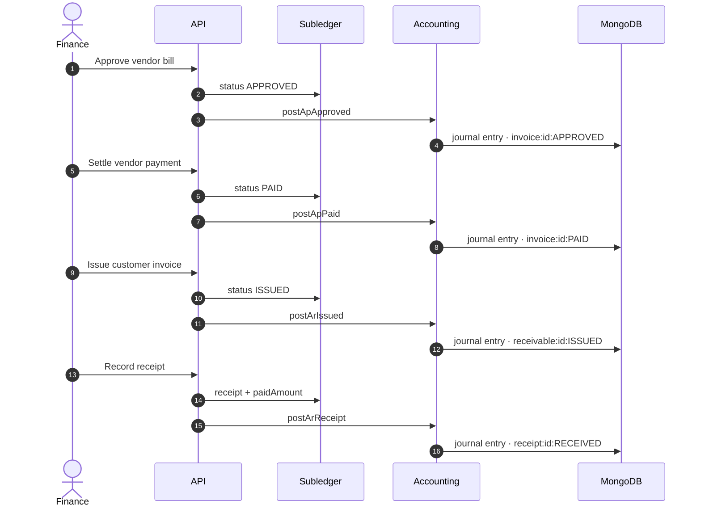

| Event | Debit | Credit |
|---|---|---|
| Vendor bill approved | 5100 Operating expenses (subtotal), 1300 Input tax (tax) | 2000 Accounts payable (total) |
| Vendor bill paid | 2000 Accounts payable | 1010 Cash & stablecoins |
| Vendor bill voided | 2000 Accounts payable | 5100 Operating expenses, 1300 Input tax |
| Customer invoice issued | 1100 Accounts receivable (total) | 4000 Revenue (subtotal), 2100 Tax payable (tax) |
| Customer receipt | 1010 Cash & stablecoins | 1100 Accounts receivable |
| Customer invoice voided | 4000 Revenue, 2100 Tax payable | 1100 Accounts receivable |
| Manual journal | chosen | chosen (must balance) |
| Opening balance | 1010 Cash & stablecoins | 3000 Retained earnings |

Balances are computed with `$toDecimal` over integer minor-unit strings. Reports are kept
per currency: there is no FX translation, matching the payment limitation. Trial balance,
P&L, AP/AR aging and the journal are served by `accounting`.

---

## 6. Agent custody (OutLayer)

Custody wallets are TEE-held. KEIZ stores only an encrypted API key. The policy
is encrypted on-chain and evaluated inside the TEE before every signature.

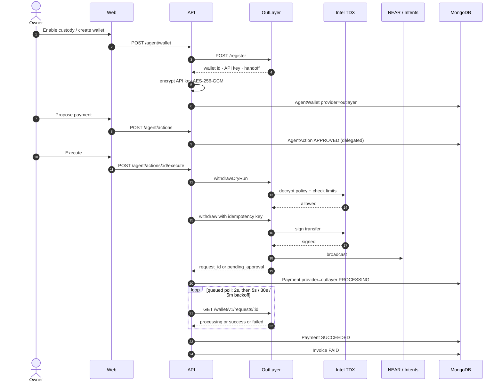

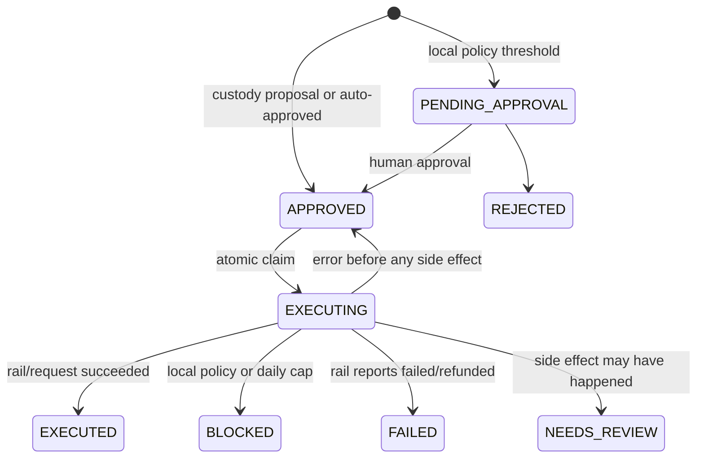

---

## 7. AI assistant

The Mastra agent is server-side. Every tool receives `orgId` from the request
context; the model never chooses the tenant. Chat can create proposals but has
no path to move funds.

The agent is plan-first and human-in-the-loop:

1. `plan-actions` is the only tool allowed before a plan is approved. A
   `beforeToolCall` hook blocks every other tool until `planApproved` is set.
2. Read-only tools run automatically after plan approval. Write/drafting tools
   (`propose-payment`, plus future `write`/`spend` tools) use
   `requireApproval: true`; Mastra suspends and emits `tool-call-approval`, the API
   maps it to an SSE `approval` event, and the UI renders a custom confirmation card.
3. `POST /chat/approvals` verifies the suspended run belongs to the caller via
   `listSuspendedRuns({ threadId, resourceId })`, then calls
   `approveToolCall` / `declineToolCall` and streams the continuation.
4. Tool results are validated against Zod `outputSchema`s and emitted as
   `card` events. Every card has a link to the relevant detail page.

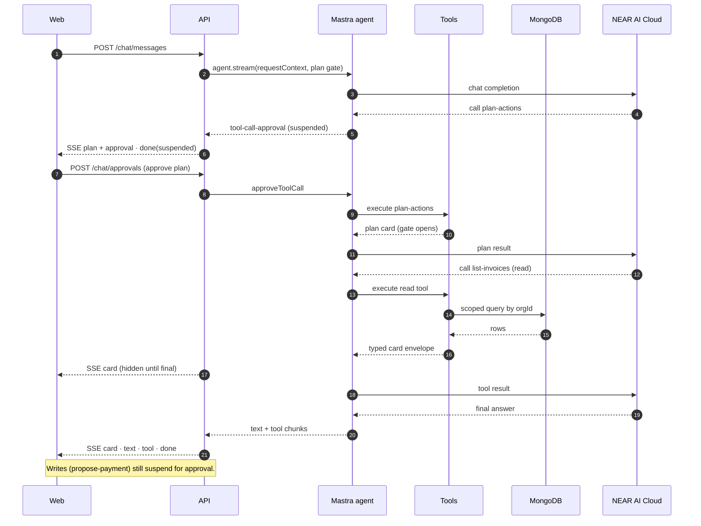

Without `NEARAI_API_KEY`, the deterministic local provider runs the same tools
through an in-memory `LocalRunStore` and emits the same plan/approval/card
protocol, so the demo and tests stay offline.

---

## 8. Data model

Application collections are owned by Mongoose. Mastra owns its own
`mastra_threads` / `mastra_messages` collections through a second Mongo client.

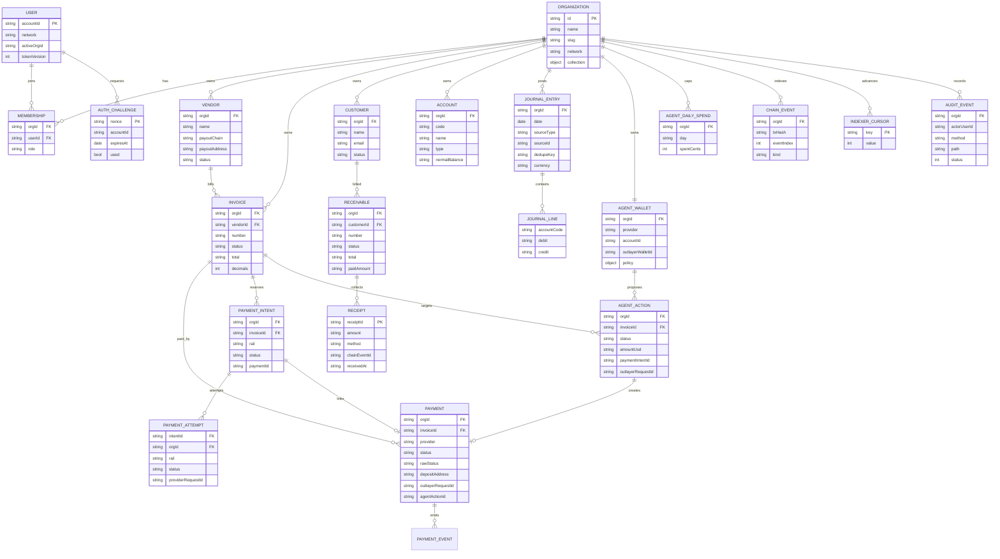

Money is stored as an integer string in the asset's smallest unit plus a
`decimals` field. Never use `Number` on a monetary value.

Key indexes and invariants:

- `payment_intents` is unique on `(orgId, invoiceId)` for `OPEN`/`EXECUTING` — one live
  obligation per invoice across all rails.
- `payments` is unique on `(orgId, invoiceId)` for `AWAITING_DEPOSIT`/`PROCESSING`,
  and on `(orgId, txHash)` and `(orgId, idempotencyKey)` when present.
- `invoices` and `receivables` are unique on `(orgId, number)`.
- `receivables.receipts.chainEventId` is a unique sparse index, so re-indexing a collect
  receipt cannot duplicate a row.
- `journal_entries` is unique on `(orgId, dedupeKey)` when `dedupeKey` exists; manual entries
  omit it. Journal rows are immutable.
- `agent_daily_spend` is unique on `(orgId, day)` and updated with a conditional `$inc`.
- `agent_wallets` is unique per org; `memberships` is unique on `(orgId, userId)`.
- `auth_challenges` has a TTL index on `expiresAt`.

See [Data model reference](./data-model.md) for every collection and field.

---

## 9. Trust boundaries

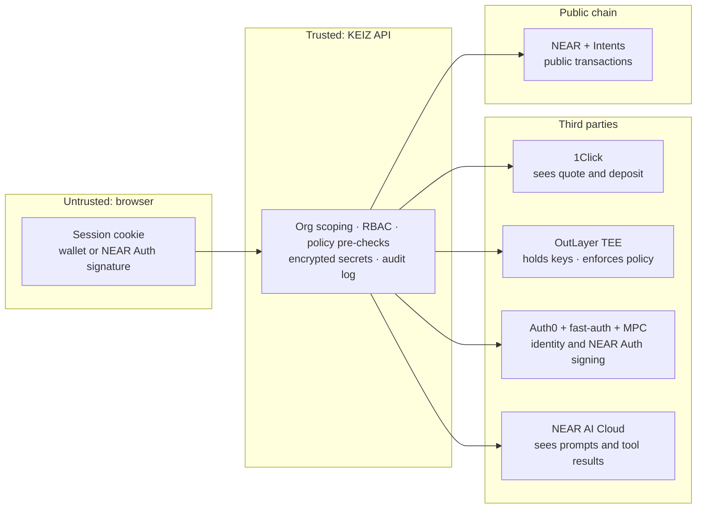

- **1Click is mainnet-only.** There is no testnet deployment.
- **OutLayer keys never leave the TEE.** The API key is full wallet authority;
  it is stored encrypted and only exposed through the OWNER handoff URL.
- **The NEAR Auth relayer** can only submit `sign` to `fast-auth`, for the
  expected guard id, within the gas cap and with a 1 yoctoNEAR deposit. It
  cannot move funds.
- **NEAR AI** receives the prompt, the conversation window, and tool results.
  Use the local provider for offline or sensitive demos.

---

## 10. Runtime and deployment

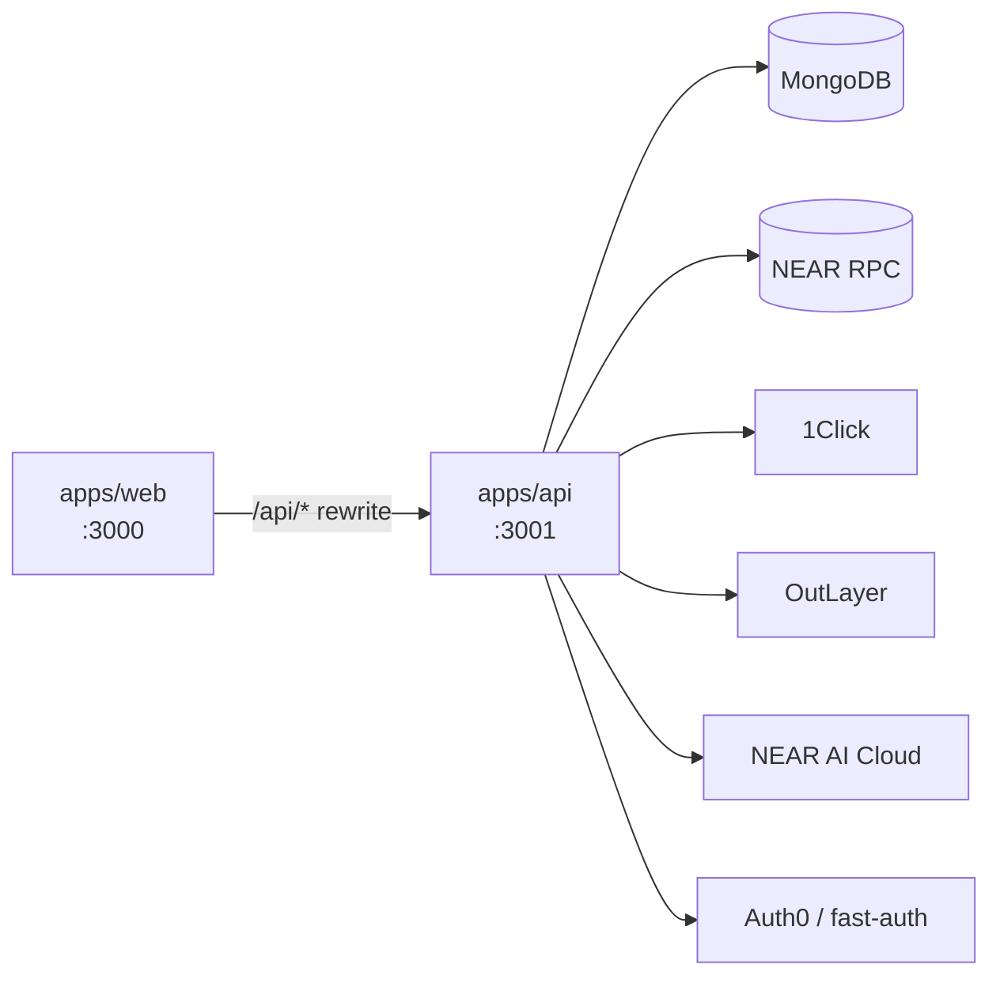

- Two long-running processes plus a worker: Next, Nest, and the BullMQ worker.
- Pollers/queue processors (`payments`, `outlayer`, `indexer`, `near-auth`) run in the worker; Redis is required (`REDIS_URL`). The API only produces jobs. Tests set `QUEUES_ENABLED=false`.
- Queue cadence: payment polls run per payment (4s default) plus a sweep every
  `PAYMENT_SWEEP_INTERVAL_MS` (30s); OutLayer polls start at 2s with 5s/30s/5m backoff plus a
  5m sweeper; the indexer syncs every `INDEXER_INTERVAL_MS` (30s); the NEAR Auth relay queue
  runs with concurrency 1. `POST /api/indexer/collect` triggers an immediate collect sync.
- Mongo is required for app state and Mastra memory. Use the same database name
  for both clients.
- `pnpm dev` runs Turbo; `pnpm build` builds shared → api → web. Stop dev before
  building because both write `apps/api/dist`.

---

## 11. Testing map

| Suite | Covers |
|---|---|
| `pnpm test` | 84 unit tests (69 API + 15 shared): money math, invoice totals, ledger posting rules, NEP-413 vectors, network guards, agent policy, SSE mapping, chat card builders, plan gate, OutLayer status map |
| `pnpm --filter @keiz/api smoke` | 50 checks: auth scoping + refresh reuse, invoices, 1Click mock settlement, AP/AR postings, receipts, trial balance, aging, rebuild, RBAC, members + org switching, duplicate quotes, audit, local chat plan/approval/cards, NEAR Auth relayer fencing |
| `pnpm --filter @keiz/api smoke:outlayer` | custody register, describe, delegated policy, withdraw, polling, invoice settlement |
| `pnpm --filter @keiz/api smoke:mastra` | Mastra plan suspension, approve/resume, typed cards, request-scoped tools, memory, thread isolation |
| `pnpm contracts:test` | collect message parsing and vault policy validation |
| `pnpm typecheck` / `pnpm build` | TypeScript and production bundles |

## 12. Related docs

- [API reference](./api.md)
- [Data model](./data-model.md)
- [Integrations & contracts](./integrations.md)
- [Contract README](../contracts/README.md)
- [Security model](../README.md#security-model)
- [Agent custody](../README.md#agent-custody-outlayer)
- [Login (NEAR Auth + wallet)](../README.md#login-near-auth--wallet)
- [Agent instructions](../AGENTS.md)
