# KEIZ — Technical Architecture

This document is the map of how KEIZ is wired: runtimes, trust boundaries, the
invoice and payment state machines, and the three login/settlement/agent flows.
Diagrams are Mermaid and render on GitHub.

- **Web** — Next.js 16 App Router, React 19, Tailwind 4
- **API** — NestJS 12, Mongoose 9, MongoDB
- **Chain** — NEAR RPC, NEAR Intents 1Click, NEAR Auth (FastAuth), OutLayer custody, NEAR AI Cloud

---

## 1. System context

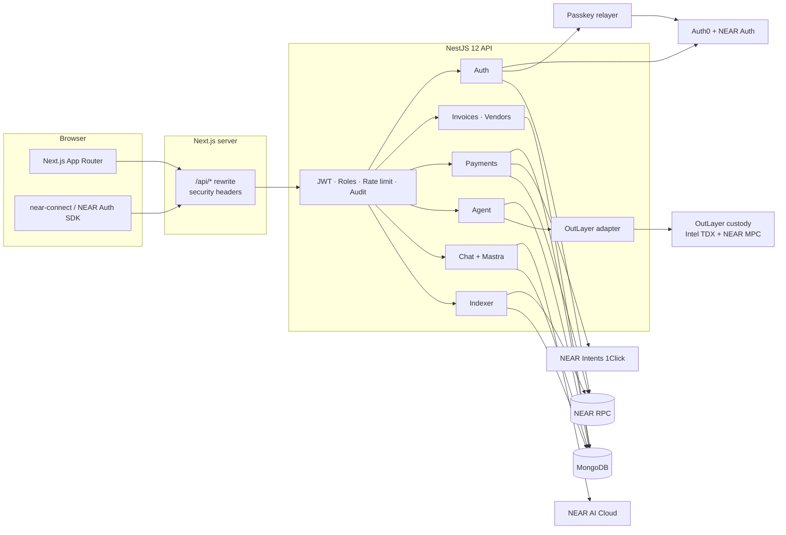

---

## 2. Monorepo map

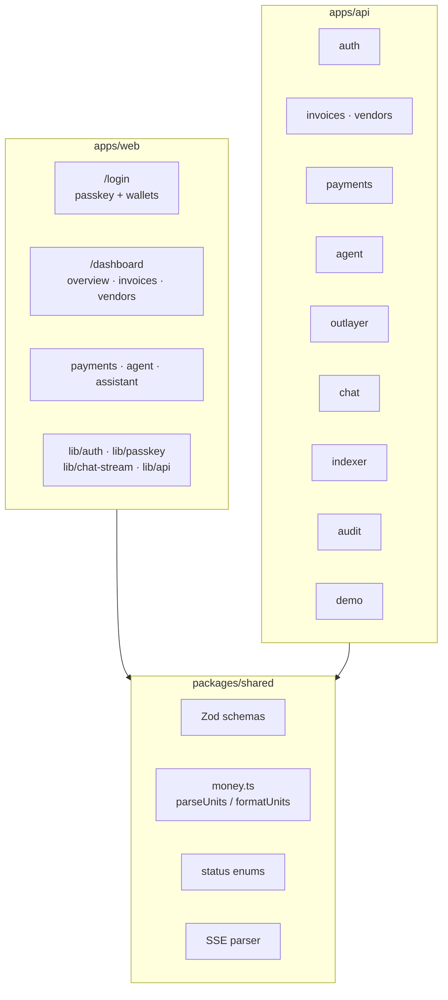

---

## 3. Request lifecycle

Every browser call goes through the Next proxy, so the httpOnly session cookie
stays same-origin. The global guards run before any controller.

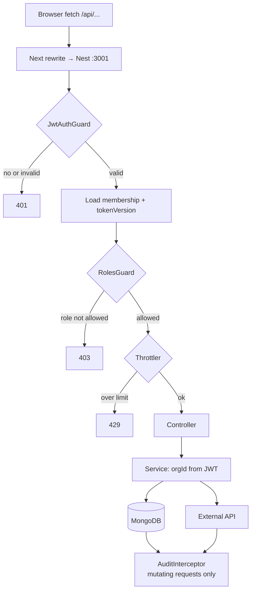

---

## 4. Authentication

### 4.1 Passkey (NEAR Auth / FastAuth)

The passkey is an Auth0 factor. The NEAR key is MPC-derived and never reaches
the browser. The API relayer submits the `sign` action to `fast-auth`; it only
accepts `sign` on the configured contract, with gas ≤ 300 TGas and zero deposit.

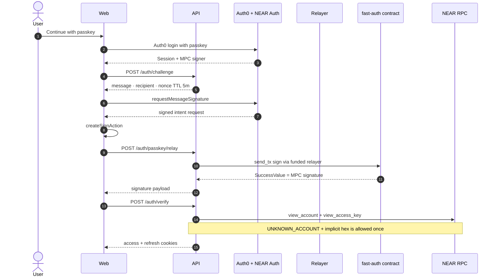

### 4.2 Wallet (NEP-413)

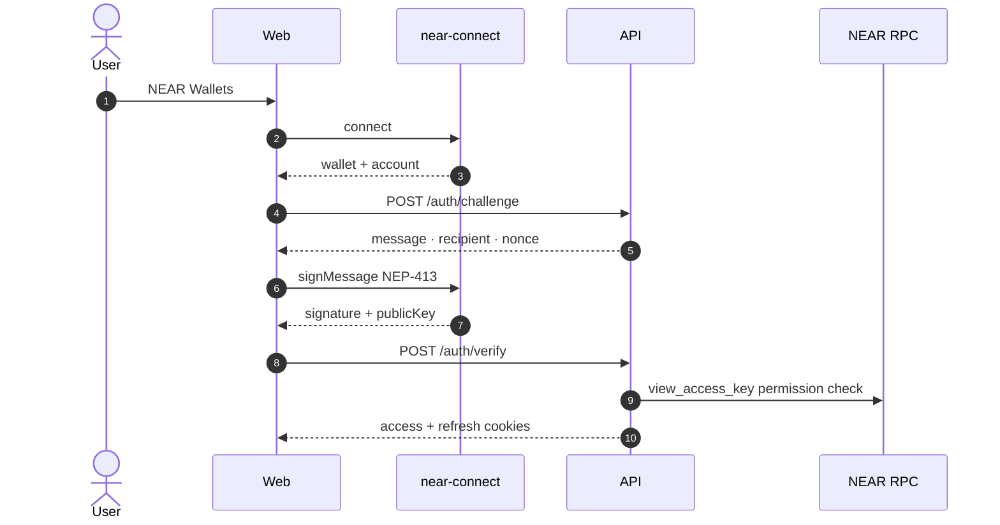

NEP-413 payload: Borsh `tag(2^31+413) || message || nonce[32] || recipient || Option<callback>`
→ SHA-256 → Ed25519. Nonces are single-use and TTL-indexed.

---

## 5. Invoice and 1Click settlement

The invoice is approved first, then a quote is committed. The deposit is signed
in the user's wallet. In `intents` mode the API verifies the transaction against
NEAR RPC before forwarding it to 1Click.

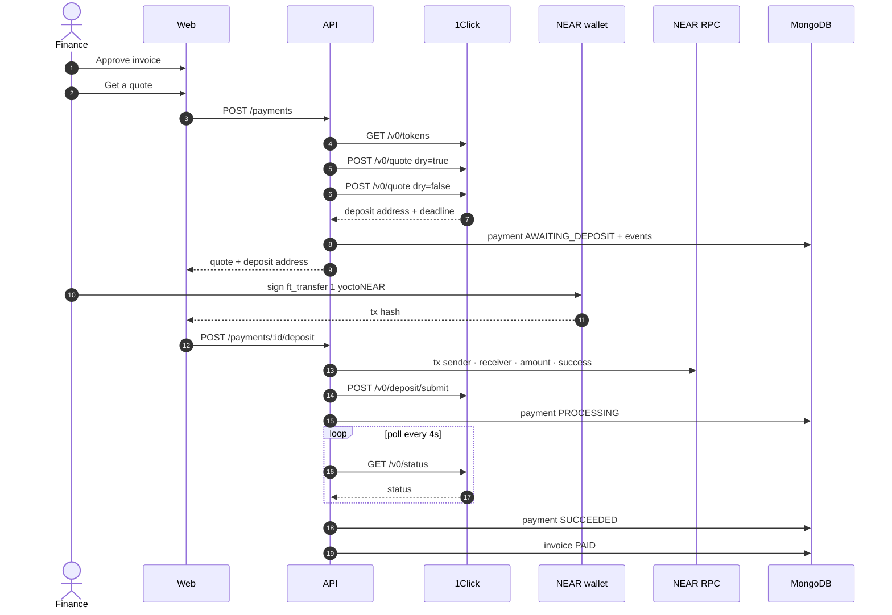

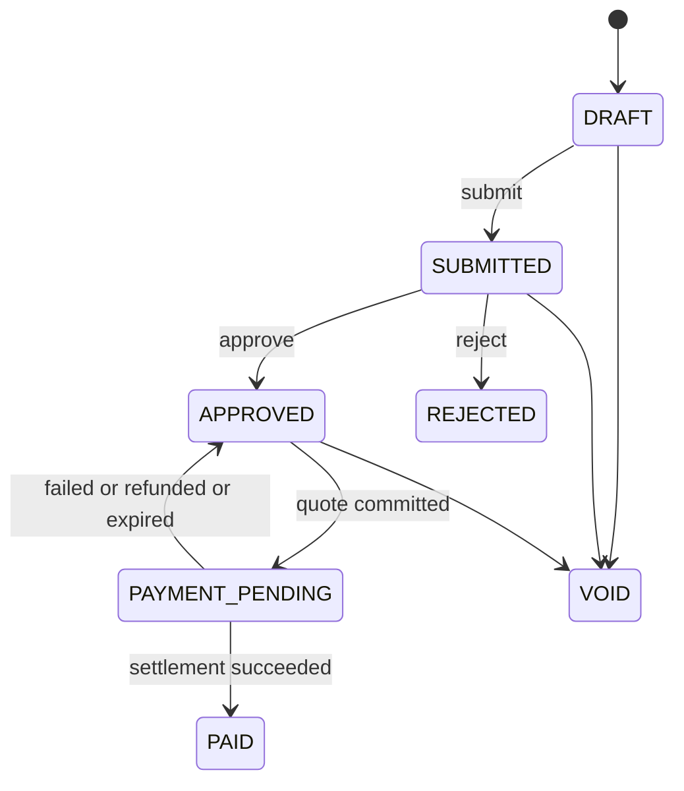

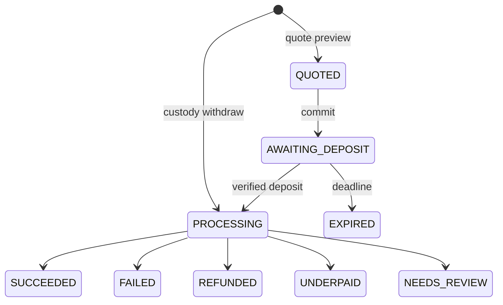

---

## 6. Agent custody (OutLayer)

Custody wallets are TEE-held. KEIZ stores only an encrypted API key. The policy
is encrypted on-chain and evaluated inside the TEE before every signature.

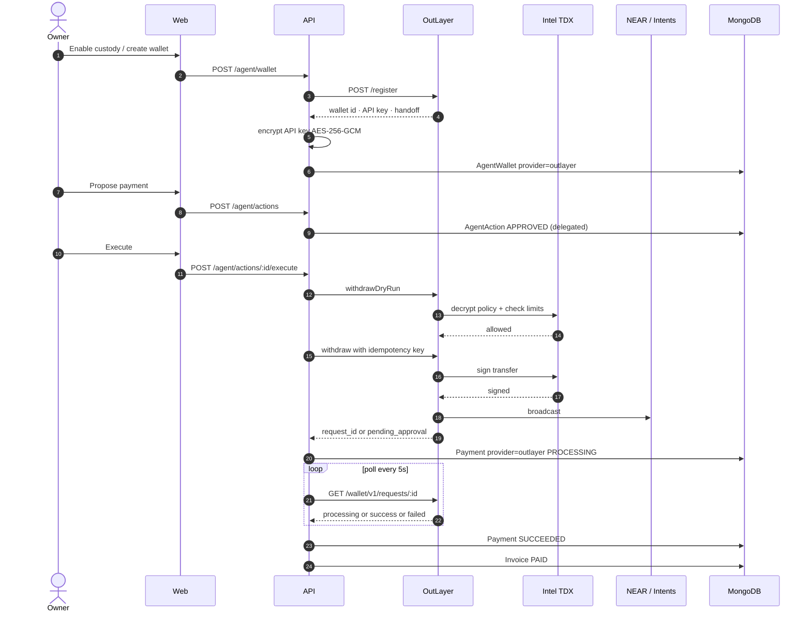

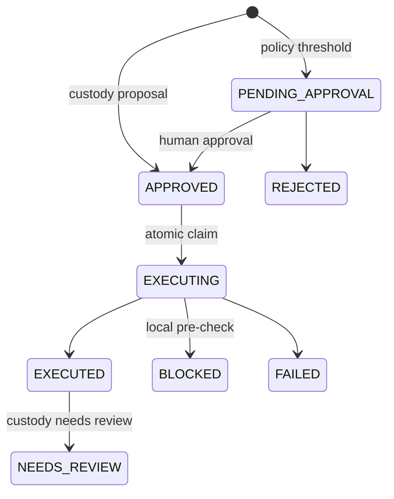

---

## 7. AI assistant

The Mastra agent is server-side. Every tool receives `orgId` from the request
context; the model never chooses the tenant. Chat can create proposals but has
no path to move funds.

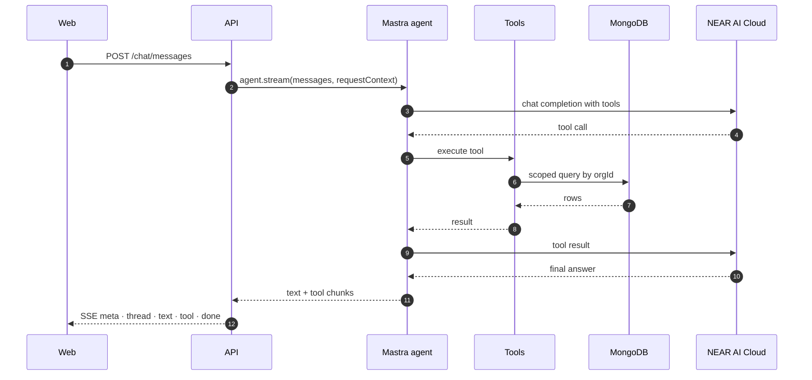

Without `NEARAI_API_KEY`, the same tools run through the deterministic local
provider, so the demo and tests stay offline.

---

## 8. Data model

Application collections are owned by Mongoose. Mastra owns its own
`mastra_threads` / `mastra_messages` collections through a second Mongo client.

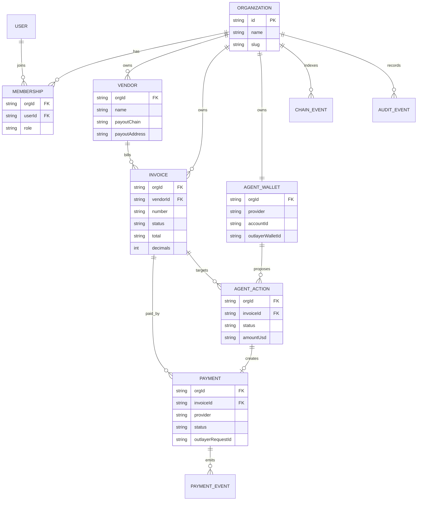

Money is stored as an integer string in the asset's smallest unit plus a
`decimals` field. Never use `Number` on a monetary value.

---

## 9. Trust boundaries

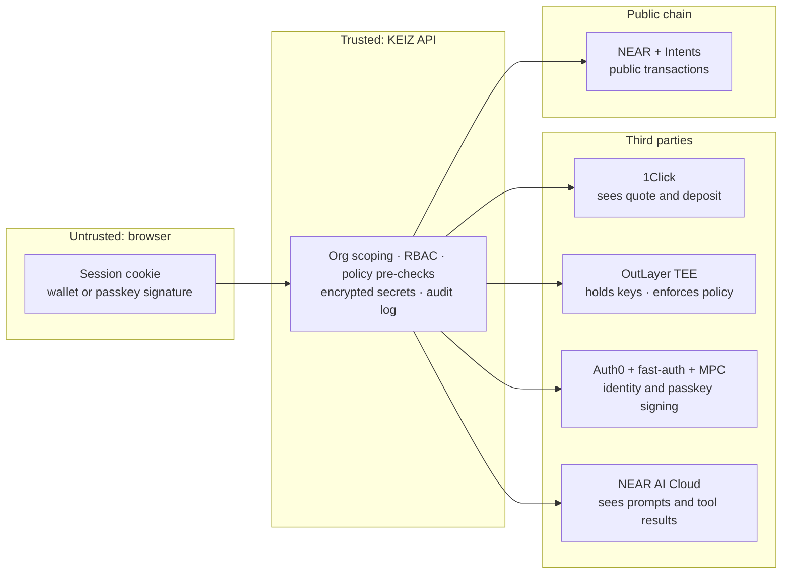

- **1Click is mainnet-only.** There is no testnet deployment.
- **OutLayer keys never leave the TEE.** The API key is full wallet authority;
  it is stored encrypted and only exposed through the OWNER handoff URL.
- **Passkey relayer** can only submit `sign` to `fast-auth`, within gas and
  deposit caps. It cannot move funds.
- **NEAR AI** receives the prompt, the conversation window, and tool results.
  Use the local provider for offline or sensitive demos.

---

## 10. Runtime and deployment

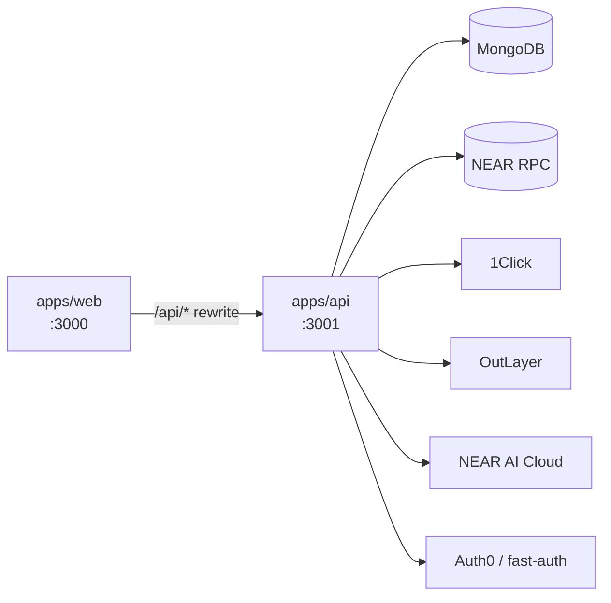

- Two long-running processes: Next and Nest.
- Pollers (`payments`, `outlayer`, `indexer`) are in-process and assume a single
  API instance. There is no Redis or queue.
- Mongo is required for app state and Mastra memory. Use the same database name
  for both clients.
- `pnpm dev` runs Turbo; `pnpm build` builds shared → api → web. Stop dev before
  building because both write `apps/api/dist`.

---

## 11. Testing map

| Suite | Covers |
|---|---|
| `pnpm test` | money math, NEP-413 vectors, agent policy, SSE mapping, OutLayer status map |
| `pnpm --filter @keiz/api smoke` | auth scoping + refresh reuse, invoices, 1Click mock settlement, RBAC, duplicate quotes, audit, local chat |
| `pnpm --filter @keiz/api smoke:outlayer` | custody register, describe, delegated policy, withdraw, polling, invoice settlement |
| `pnpm --filter @keiz/api smoke:mastra` | Mastra stream chunks, request-scoped tools, memory, thread isolation |
| `pnpm typecheck` / `pnpm build` | TypeScript and production bundles |

## 12. Related docs

- [Security model](../README.md#security-model)
- [Agent custody](../README.md#agent-custody-outlayer)
- [Passkey login](../README.md#passkey-login-near-auth)
- [Agent instructions](../AGENTS.md)
